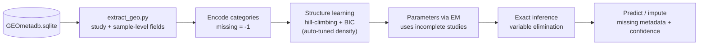
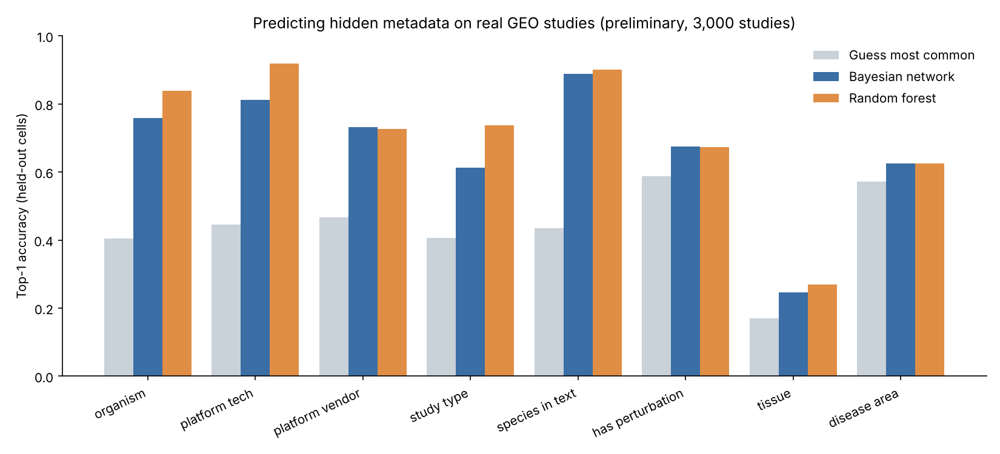
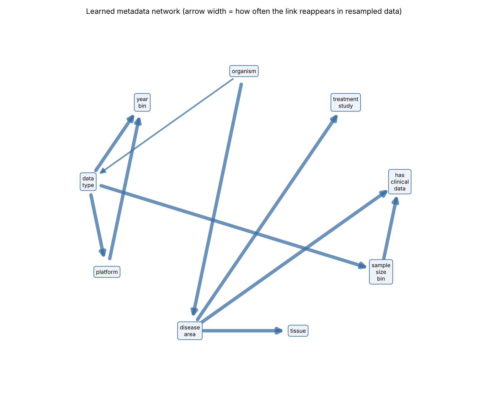

<h1 align="center">🧬 metadata-bn</h1>
<p align="center"><b>Bayesian networks that predict the missing metadata of biomedical studies.</b><br>
Learn how study annotations depend on each other — then fill in the blanks, with probabilities.</p>

<p align="center">
  
  
  
  
</p>

---

## ✨ Why

Public repositories such as [GEO](https://www.ncbi.nlm.nih.gov/geo/) hold hundreds of thousands of molecular studies, but many are
poorly annotated: the tissue, disease or technology is missing, so the data is hard to find and reuse.
Metadata fields are not independent — a human cancer study tends to use particular platforms, sample sizes and tissues.
**metadata-bn** learns those dependencies as a Bayesian network and uses them to predict what is missing.

## 🔬 How it works



| Step | What it does |
|---|---|
| **Extract** | Pulls one row per GEO series: organism, platform, study type, year, sample size, species/cell-line/perturbation flags, and tissue/disease from sample annotations. |
| **Learn structure** | Greedy hill-climbing on BIC, tolerant of missing values; whitelist/blacklist edges for domain knowledge; density tuned on a validation split. |
| **Fit parameters** | Dirichlet-smoothed tables, then EM so partially-annotated studies still count. |
| **Predict** | Exact variable elimination → a probability for every value of every missing field. |
| **Explain** | Bootstrap edge stability, Markov blankets, and a network diagram. |

## 🚀 Quick start

```bash
git clone https://github.com/YOUR-USERNAME/metadata-bn.git
cd metadata-bn
python -m pip install -r requirements.txt

python demo.py                 # synthetic benchmark, runs in seconds
python -m pytest -q            # unit tests
```

**On real GEO data** (needs `GEOmetadb.sqlite`, ~19 GB — see [Data](#-data)):

```bash
python run_all.py --quick      # ~1 minute test on 3,000 studies
python run_all.py --n 60000    # full run (tuning + random-forest comparison + diagram)
```

Outputs land in `results/`: `report.txt`, `network.png`, `imputed.csv`, `model.pkl`.

### Use as a library

```python
from metadata_bn import MetadataBN
import pandas as pd

df = pd.read_csv("studies.csv")          # one row per study, one column per metadata field
model = MetadataBN().fit(df)

model.predict({"organism": "Homo sapiens", "is_cell_line": "no", "disease_area": "cancer"})
# -> top-3 most likely values (with probabilities) for every field not provided

model.fill_missing(df)                    # impute every missing cell + confidence columns
model.markov_blanket("tissue")            # which fields actually inform tissue
```

## 📊 Preliminary results (real GEO data)

<p align="center"></p>

Each observed value of a held-out study is hidden and predicted from that study's other fields (3,000-study quick run).
**Treat these as preliminary**: ~200–600 test cells per field, so differences of a few points are within noise.

| Field | Guess most common | Bayesian network | Random forest |
|---|---:|---:|---:|
| organism | 0.41 | **0.76** | 0.84 |
| platform technology | 0.45 | **0.81** | 0.92 |
| study type | 0.41 | **0.61** | 0.74 |
| tissue | 0.17 | **0.25** | 0.27 |
| disease area | 0.57 | **0.63** | 0.63 |

**Honest reading:** the network clearly beats guessing on fields that are informative about each other, but a random forest is
as accurate or better on raw top-1 accuracy. The network's value is that it handles missing values natively,
returns probabilities, and exposes *which* fields depend on which. Tissue and disease remain the hard cases — see the roadmap.

### What the network learns

<p align="center"></p>
<p align="center"><sub>Learned network on synthetic data (<code>python demo.py</code>); arrow width = how often the link reappears in resampled data.</sub></p>

## 🗂 Project structure

```
metadata-bn/
├── metadata_bn/            # the library
│   ├── data.py             #   category encoding, missing values, rare-label merging
│   ├── structure.py        #   hill-climbing structure learning (BIC, white/blacklists)
│   ├── network.py          #   CPTs, EM for incomplete data, sampling
│   ├── inference.py        #   exact variable elimination
│   ├── model.py            #   high-level API (fit / predict / fill_missing)
│   ├── tune.py             #   automatic network-density selection
│   ├── evaluate.py         #   held-out imputation accuracy, structure recovery
│   ├── benchmark.py        #   random-forest comparison
│   ├── viz.py              #   bootstrap edge confidence + diagram
│   ├── vocab.py            #   tissue / disease / species synonym vocabularies
│   └── synthetic.py        #   ground-truth generator for tests and demos
├── extract_geo.py          # GEOmetadb.sqlite -> studies.csv
├── run_pipeline.py         # train + evaluate + impute on a CSV
├── run_all.py              # one command: extract -> train -> evaluate -> report
├── demo.py                 # synthetic end-to-end demo
├── predict_example.py      # query a trained model
└── tests/
```

## 💾 Data

The database is **not** included (≈19 GB). Get GEOmetadb with R:

```r
install.packages("BiocManager"); BiocManager::install("GEOmetadb")
library(GEOmetadb); getSQLiteFile()      # downloads GEOmetadb.sqlite
```

Place `GEOmetadb.sqlite` in the project folder (or pass `--db PATH`). `run_all.py` also searches your Downloads folder.
Any CSV of categorical study metadata works too: `python run_pipeline.py my_studies.csv`.

<details>
<summary><b>⚙️ Method details</b></summary>

- **Encoding.** Categorical fields → integers; missing/“unknown”/“NA” → −1; labels with fewer than `min_count` studies merged into `__other__`.
- **Structure learning.** Greedy add / delete / reverse moves, acyclicity enforced. Family BIC is computed on available cases and rescaled to the full sample size so fields with different missingness stay comparable. A `penalty` factor (<1 gives denser networks) and `max_parents` are chosen by validation accuracy when `--tune` is on.
- **Parameters.** BDeu-style Dirichlet smoothing; EM over unique row patterns (missing-at-random assumption).
- **Inference.** Variable elimination with barren-node pruning and a min-size elimination order; verified against brute-force enumeration in the tests.
- **Evaluation.** Every observed cell of held-out studies is hidden in turn and predicted from the study's remaining fields, against a majority-class baseline and a random forest.
- **Edge confidence.** Structure is re-learned on bootstrap resamples; the table reports how often each edge (and its direction) reappears.

</details>

## ⚠️ Limitations

- Tissue and disease labels come from **synonym matching** on text (`vocab.py`), not curated ontologies, so they are noisy; evaluation measures agreement with those labels.
- Missingness is assumed random; real annotators skip fields systematically.
- Only categorical fields (numbers are binned); fields with hundreds of categories (e.g. platform ID) work poorly.
- Edge directions are not reliably causal — observational data cannot always orient edges.
- Developed and tested on GEO only.

## 🗺 Roadmap

- [x] Structure learning, EM, exact inference, tests
- [x] GEOmetadb extraction with sample-level annotations
- [x] Random-forest comparison, edge stability, diagram, auto-tuned density
- [ ] Map tissue/disease to official ontologies (UBERON, MONDO)
- [ ] Text features from titles and abstracts (topic clusters / LLM tags)
- [ ] Features derived from the molecular data itself (e.g. predicted sex, tissue signatures)
- [ ] Missing-not-at-random modelling
- [ ] Other repositories (TCGA, ArrayExpress)

## 📄 License

MIT — see [LICENSE](LICENSE).
